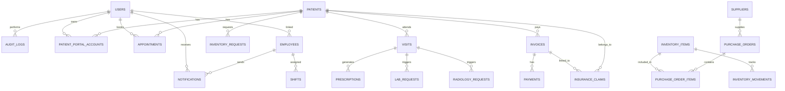

# HMS Phase 5 ERD na Database Design

## 1. Moduli za ziada zinazofuata

Zifuatazo ni moduli muhimu kwa awamu ya mwisho ya mfumo wa hospitali:

- Inventory na Store Keeper
- Notifications na Mawasiliano
- Patient Portal
- Audit Logs / Security
- Backup and system metadata
- Future extension ya multi-branch

---

## 2. ERD ya jumla



---

## 3. Core tables za moduli mpya

### 3.1 audit_logs

```sql
CREATE TABLE audit_logs (
    id BIGINT UNSIGNED PRIMARY KEY AUTO_INCREMENT,
    user_id BIGINT UNSIGNED NULL,
    user_type VARCHAR(100) NULL,
    action VARCHAR(100) NOT NULL,
    module_name VARCHAR(100) NOT NULL,
    model_type VARCHAR(150) NULL,
    model_id BIGINT UNSIGNED NULL,
    description TEXT NULL,
    ip_address VARCHAR(45) NULL,
    user_agent TEXT NULL,
    created_at TIMESTAMP NULL,
    FOREIGN KEY (user_id) REFERENCES users(id) ON DELETE SET NULL
);
```

Important rules:
- No delete on audit row
- Typical indexes: user_id, model_type + model_id, created_at

### 3.2 notifications

```sql
CREATE TABLE notifications (
    id BIGINT UNSIGNED PRIMARY KEY AUTO_INCREMENT,
    user_id BIGINT UNSIGNED NOT NULL,
    title VARCHAR(255) NOT NULL,
    message TEXT NOT NULL,
    type VARCHAR(50) DEFAULT 'info',
    read_at TIMESTAMP NULL,
    metadata JSON NULL,
    created_at TIMESTAMP NULL,
    updated_at TIMESTAMP NULL,
    FOREIGN KEY (user_id) REFERENCES users(id) ON DELETE CASCADE
);
```

### 3.3 patient_portal_accounts

```sql
CREATE TABLE patient_portal_accounts (
    id BIGINT UNSIGNED PRIMARY KEY AUTO_INCREMENT,
    patient_id BIGINT UNSIGNED NOT NULL,
    user_id BIGINT UNSIGNED NULL,
    portal_username VARCHAR(100) UNIQUE NOT NULL,
    status ENUM('active', 'disabled', 'pending') DEFAULT 'pending',
    last_login_at TIMESTAMP NULL,
    created_at TIMESTAMP NULL,
    updated_at TIMESTAMP NULL,
    FOREIGN KEY (patient_id) REFERENCES patients(id) ON DELETE CASCADE,
    FOREIGN KEY (user_id) REFERENCES users(id) ON DELETE SET NULL
);
```

### 3.4 inventory_items

```sql
CREATE TABLE inventory_items (
    id BIGINT UNSIGNED PRIMARY KEY AUTO_INCREMENT,
    item_code VARCHAR(100) UNIQUE NOT NULL,
    name VARCHAR(255) NOT NULL,
    category VARCHAR(100) NOT NULL,
    unit VARCHAR(50) NOT NULL,
    reorder_level INT DEFAULT 0,
    current_stock INT DEFAULT 0,
    status ENUM('active','inactive','low_stock') DEFAULT 'active',
    supplier_id BIGINT UNSIGNED NULL,
    created_at TIMESTAMP NULL,
    updated_at TIMESTAMP NULL,
    FOREIGN KEY (supplier_id) REFERENCES suppliers(id) ON DELETE SET NULL
);
```

### 3.5 suppliers

```sql
CREATE TABLE suppliers (
    id BIGINT UNSIGNED PRIMARY KEY AUTO_INCREMENT,
    name VARCHAR(255) NOT NULL,
    contact_person VARCHAR(255) NULL,
    phone VARCHAR(50) NULL,
    email VARCHAR(150) NULL,
    address TEXT NULL,
    tax_number VARCHAR(100) NULL,
    status ENUM('active', 'inactive') DEFAULT 'active',
    created_at TIMESTAMP NULL,
    updated_at TIMESTAMP NULL
);
```

### 3.6 purchase_orders

```sql
CREATE TABLE purchase_orders (
    id BIGINT UNSIGNED PRIMARY KEY AUTO_INCREMENT,
    po_number VARCHAR(100) UNIQUE NOT NULL,
    supplier_id BIGINT UNSIGNED NOT NULL,
    ordered_by BIGINT UNSIGNED NOT NULL,
    order_date TIMESTAMP NULL,
    expected_date TIMESTAMP NULL,
    status ENUM('draft','approved','received','cancelled') DEFAULT 'draft',
    total_amount DECIMAL(12,2) DEFAULT 0,
    created_at TIMESTAMP NULL,
    updated_at TIMESTAMP NULL,
    FOREIGN KEY (supplier_id) REFERENCES suppliers(id) ON DELETE CASCADE,
    FOREIGN KEY (ordered_by) REFERENCES users(id) ON DELETE RESTRICT
);
```

### 3.7 purchase_order_items

```sql
CREATE TABLE purchase_order_items (
    id BIGINT UNSIGNED PRIMARY KEY AUTO_INCREMENT,
    purchase_order_id BIGINT UNSIGNED NOT NULL,
    inventory_item_id BIGINT UNSIGNED NOT NULL,
    quantity INT NOT NULL,
    unit_cost DECIMAL(12,2) DEFAULT 0,
    total_cost DECIMAL(12,2) DEFAULT 0,
    created_at TIMESTAMP NULL,
    updated_at TIMESTAMP NULL,
    FOREIGN KEY (purchase_order_id) REFERENCES purchase_orders(id) ON DELETE CASCADE,
    FOREIGN KEY (inventory_item_id) REFERENCES inventory_items(id) ON DELETE CASCADE
);
```

### 3.8 inventory_movements

```sql
CREATE TABLE inventory_movements (
    id BIGINT UNSIGNED PRIMARY KEY AUTO_INCREMENT,
    inventory_item_id BIGINT UNSIGNED NOT NULL,
    movement_type ENUM('in','out','adjustment','return') NOT NULL,
    quantity INT NOT NULL,
    reference_type VARCHAR(50) NULL,
    reference_id BIGINT UNSIGNED NULL,
    remarks TEXT NULL,
    moved_by BIGINT UNSIGNED NULL,
    created_at TIMESTAMP NULL,
    FOREIGN KEY (inventory_item_id) REFERENCES inventory_items(id) ON DELETE CASCADE,
    FOREIGN KEY (moved_by) REFERENCES users(id) ON DELETE SET NULL
);
```

### 3.9 backup_logs

```sql
CREATE TABLE backup_logs (
    id BIGINT UNSIGNED PRIMARY KEY AUTO_INCREMENT,
    backup_name VARCHAR(255) NOT NULL,
    storage_path VARCHAR(255) NOT NULL,
    file_size BIGINT NULL,
    status ENUM('success','failed') DEFAULT 'success',
    created_at TIMESTAMP NULL,
    updated_at TIMESTAMP NULL
);
```

---

## 4. Recommended relationships

### Patient Portal
- `patients` -> `patient_portal_accounts`
- `users` -> `patient_portal_accounts`
- `patient_portal_accounts` can be used to authenticate patient portal access separately from staff users

### Inventory
- `suppliers` -> `purchase_orders`
- `purchase_orders` -> `purchase_order_items`
- `inventory_items` -> `purchase_order_items`
- `inventory_items` -> `inventory_movements`

### Audit + security
- Every `create`, `update`, `delete`, `approve`, `print`, `login`, `logout`, `reset password` action should write to `audit_logs`
- `audit_logs` should never be deletable from the UI

### Notifications
- notifications should be linked to `users`
- each notification can carry a JSON payload with route, module, and object id

---

## 5. Migration order iliyopendekezwa

1. `suppliers`
2. `inventory_items`
3. `purchase_orders`
4. `purchase_order_items`
5. `inventory_movements`
6. `notifications`
7. `patient_portal_accounts`
8. `audit_logs`
9. `backup_logs`

---

## 6. Architecture notes

- Use `users` as central auth table for both staff and patient portal accounts.
- Patient access should be RBAC-based with role `patient` and separate permission scopes.
- Inventory should have stock alerts and expiry alerts triggered by scheduled jobs.
- Use `JSON` for metadata on notifications, portal tokens, and integrations.
- Store `audit_logs` separately from normal business tables and block delete access even for admin.

---

## 7. Next implementation plan

### Awamu ya 5
- Inventory + suppliers + purchase orders
- Notifications + email/SMS queue
- Patient portal login and account management
- Audit log viewer + system security logs
- Backup configuration and restore process

### Recommended sequence
1. Inventory schema
2. Notification table + jobs
3. Patient portal account + login flow
4. Audit log + access policies
5. Reports and export polish

If unataka, nitaendelea na hatua ya kwanza ya awamu hii ya 5 kwa kufanya actual migration files na models za `Supplier`, `InventoryItem`, `PurchaseOrder`, `Notification`, na `AuditLog` ndani ya Laravel project hii.
