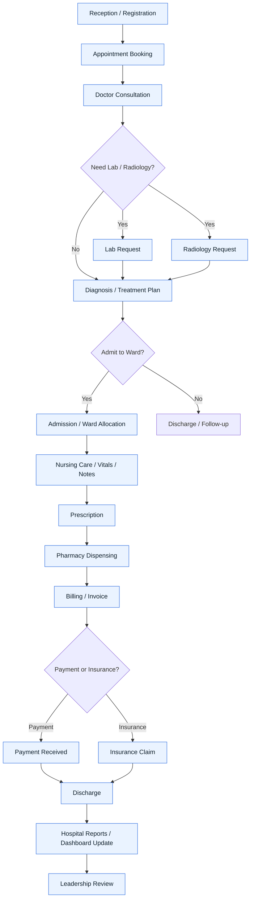

# Patient Journey Flow

## 1. Workflow ya mtiririko wa mgonjwa

## 2. Patient journey kwa kifupi kwa kila department

### Reception
- Register patient
- Book appointment
- Confirm contact details and patient history

### Doctor / Clinical
- Review patient
- Record diagnosis
- Request lab or radiology
- Prescribe medicine
- Decide admission or discharge

### Nursing / Ward
- Admit patient
- Record vitals
- Update nursing notes
- Monitor patient progress
- Discharge patient when ready

### Laboratory
- Receive sample request
- Run investigation
- Update result status
- Send result to clinician

### Radiology
- Receive imaging request
- Complete imaging report
- Attach results
- Send to doctor

### Pharmacy
- Receive prescription
- Dispense medication
- Update inventory movement
- Confirm medicine issued

### Billing / Finance
- Generate invoice
- Receive payment
- Submit insurance claim
- Reconcile financial records

### Management / Leadership
- Review dashboard
- Monitor occupancy and mortality
- Check clinical zone capacity
- Monitor action queue and alerts

## 3. Fomu ya Patient Journey (short form)

| Stage | Department | Activity |
| --- | --- | --- |
| 1 | Reception | Register patient and book appointment |
| 2 | Doctor | Clinical review and diagnosis |
| 3 | Lab / Radiology | Request and receive tests |
| 4 | Doctor | Treatment plan and prescription |
| 5 | Nursing | Admit to ward and monitor care |
| 6 | Pharmacy | Dispense medicine |
| 7 | Billing | Invoice and payment processing |
| 8 | Management | Dashboard and report review |
| 9 | Discharge | Final patient exit and records close |

## 4. Summary

Mtiririko huu unaonyesha jinsi data inavyosogezwa kutoka hatua ya kwanza ya mgonjwa kufika hospital hadi hatua ya kutoka hospital, huku kila department ikihusika kwa sehemu yake ya kazi. Mfumo unaweka data zote katika database na kuifanya ipatikane kwenye dashboard na reports kwa ufuatiliaji wa hospital mzima.
